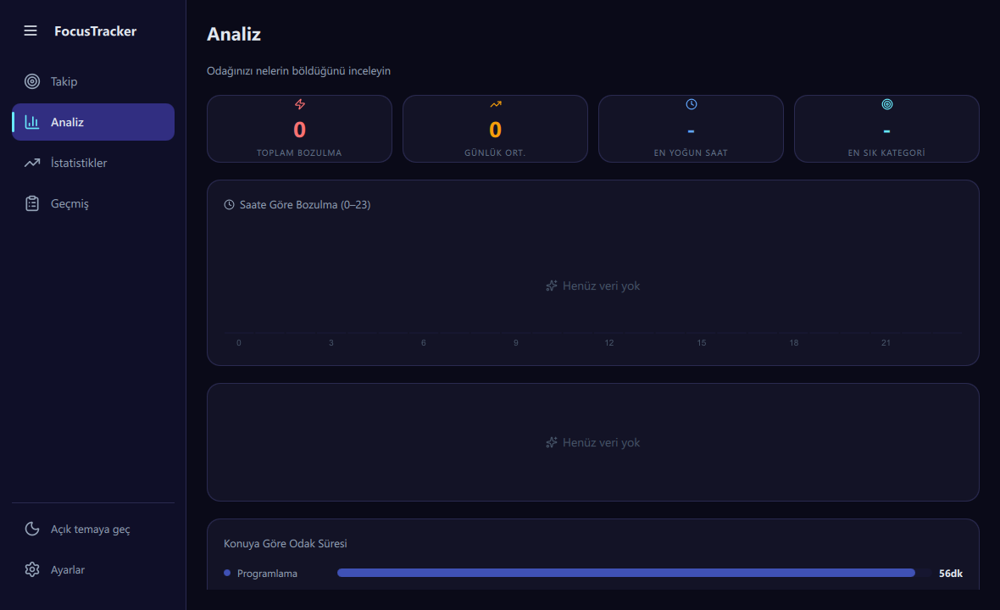
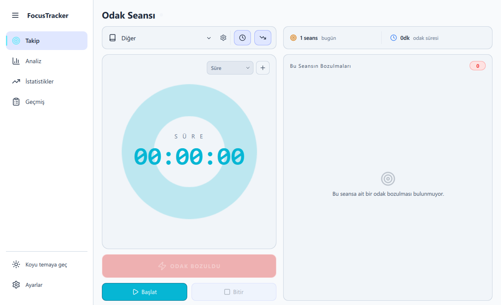

# FocusTracker


**FocusTracker**, Pomodoro tekniği ve derin odaklanma (*deep work*) ilkelerini temel alan; masaüstü deneyimini modern **Qt Quick (QML)** ve **QtQuick3D** teknolojileriyle zenginleştiren yeni nesil bir zaman yönetimi ve üretkenlik uygulamasıdır.

Uygulamanın temel felsefesi:  
> *Yalnızca ne kadar süre çalıştığınızı değil; nasıl çalıştığınızı, dikkatinizi nelerin böldüğünü ve odak kalitenizin zaman içindeki gelişimini ölçmek.*

---

## 📸 Ekran Görüntüleri

| 🎯 Odak Seansı (Koyu Tema) | 🏝️ 3D Yüzen Ada (Şehir & Kale Evresi) |
| :---: | :---: |
|  |  |

| 📊 Kapsamlı Analiz ve Dağılım | 🏝️ 3D Yüzen Ada (Kulübe Evresi) |
| :---: | :---: |
|  |  |

| 📜 Seans Geçmişi ve Filtreleme | ☀️ Odak Seansı (Açık Tema) |
| :---: | :---: |
|  |  |

---

## 🌟 Öne Çıkan Özellikler

### 1. 🎯 Gelişmiş Odaklanma Zamanlayıcısı
- **Serbest Kronometre Modu:** Önceden süre sınırı koymadan derin çalışmaya dalın; çalıştığınız süreyi saniye saniye takip eder.
- **Katı Pomodoro Modu:** Belirlediğiniz çalışma ve mola döngüleriyle (örn. 25 dk Odak / 5 dk Mola) disiplinli çalışma seansları oluşturur.
- **Tek Tıkla Süre Önayarları (Presets):** 15, 25, 45, 60, 90 dakika gibi sık kullanılan süreleri tek tıkla başlatma veya yeni özel önayarlar tanımlama imkanı.
- **Daima Üstte Mini Pencere Modu (PiP):** Ana pencere dikkatinizi dağıtıyorsa ekranın bir köşesinde sürekli görünen, seansı duraklatıp bitirebileceğiniz kompakt mini moda geçebilirsiniz.

### 2. 🏝️ 3D Yüzen Ada ve Medeniyet Simülasyonu (Gamification)
- **Forest Tarzı Kümülatif İlerleme:** Odaklandığınız her seans adanızda yeni bir ağaç yeşertir. Başarıyla tamamlanan seanslar dersinize/projenize ait renkle çam veya meşe ağacına dönüşürken, yarım kalan seanslar taze filizli kesik kütüklere dönüşür.
- **6 Aşamalı Gelişen Medeniyet:** Toplam odak süreniz arttıkça adanız seviye atlar:
  1. *Kulübe (Hut)* ➔ Saz çatılı balıkçı/orman kulübesi
  2. *Ev (House)* ➔ Taş zeminli, ahşap karkaslı kır evi
  3. *Çiftlik (Farm)* ➔ Dönen yel değirmeni ve kırmızı ahır
  4. *Köy (Village)* ➔ Taş avlulu evler ve su kuyusu
  5. *Kasaba (Town)* ➔ Saat kuleli belediye konağı ve loncalar
  6. *Şehir & Kale (Castle)* ➔ Mazgallı surlar, 4 köşe kulesi ve sancaklı iç kale
- **Başarım Binaları:** 
  - *Deniz Feneri:* Maraton başarımı kazanıldığında adanın kayalığına yerleşir ve 360° ışık huzmesi saçar.
  - *Zafer Anıtı:* 100 seans başarımı ile mermer kaideli ve altın başlıklı dikilitaş yükselir.
- **İnteraktif 3D Kontroller:** Fare ile 360° serbest döndürme (orbit), eğme açısı (pitch), tekerlekle yakınlaşma/uzaklaşma (zoom) ve çift tıkla kamerayı sıfırlama.
- **4 Dinamik Biyom Teması:** Varsayılan, Sonbahar (kehribar yapraklar), Kış (karlı platolar) ve Gece (pencereleri ışıldayan yapılar).

### 3. ⚡ Odak Bozulması Takibi (Distraction Analytics)
- Çalışırken dikkatiniz dağıldığında (telefon, ani toplantı, gürültü vb.) tek tıkla **"Odak Bozuldu"** butonuna basarak nedeni kaydedin.
- Dikkatinizin hangi saatlerde ve en çok hangi kategoriler nedeniyle dağıldığını grafikler üzerinde analiz edin.

### 4. 📊 Kapsamlı Analiz ve Raporlama
- **Süre ve Kategori Dağılımı:** Hangi projelere ne kadar vakit ayırdığınızı gösteren oransal çubuklar ve grafikler.
- **Trend ve Seri (Streak) Takibi:** Önceki döneme göre odak artış/azalış yüzdesi ve ardışık gün serisi.
- **Zaman Dilimi Filtreleri:** Günlük, haftalık, aylık ve yıllık görünüm modları.

### 5. 🎨 Modern Arayüz ve Akıllı Ekran Desteği
- **Koyu ve Açık Tema:** Göz yormayan koyu tema ile ferah açık tema arasında anında geçiş.
- **Çoklu Monitör Güvenliği:** Sanal ekran (VDD) veya çoklu monitör kurulumlarında pencerenin ekran sınırları dışına taşmasını engelleyen otomatik geometrik hizalama.
- **Sistem Tepsisi (Tray) & Global Kısayol:** `Ctrl+Shift+F` kısayolu ile arka plandayken dahi seansı duraklatabilir veya başlatabilirsiniz.

### 6. 🔄 Kesintisiz ve Güvenli Güncelleme Altyapısı
- Uygulama açılışta GitHub Releases havuzunu kontrol eder.
- Windows Akıllı Uygulama Denetimi (Smart App Control) ile tam uyumlu **kararlı EXE mimarisi** sayesinde güncellemeler güvenlik uyarılarına takılmadan arka planda kurulur.

---

## 🚀 Kurulum Rehberi

### A) Kurulum Sihirbazı ile Kurulum (Kullanıcılar İçin - Önerilen)

1. [GitHub Releases](https://github.com/Yusufygc/Desktop_Focus_Tracker/releases) sayfasından en son yayınlanan `FocusTracker-Setup-X.Y.Z.exe` dosyasını indirin.
2. Kurulum sihirbazını çalıştırarak kurulumu tamamlayın.
3. Masaüstündeki veya Başlat menüsündeki **FocusTracker** kısayolundan uygulamayı başlatın.

### B) Kaynak Koddan Çalıştırma (Geliştiriciler İçin)

Projeyi yerel geliştirme ortamınızda çalıştırmak için:

1. **Depoyu Klonlayın:**
   ```bash
   git clone https://github.com/Yusufygc/Desktop_Focus_Tracker.git
   cd Desktop_Focus_Tracker
   ```

2. **Sanal Ortamı Oluşturun ve Aktive Edin:**
   ```bash
   python -m venv venv
   .\venv\Scripts\activate   # Windows
   ```

3. **Gerekli Paketleri Yükleyin:**
   ```bash
   pip install -r requirements.txt
   ```

4. **Uygulamayı Başlatın:**
   ```bash
   python main.py
   ```

5. **Birim Testlerini Çalıştırın:**
   ```bash
   pytest
   ```

---

## 🛠️ Kurulum Paketi Derleme (Build & Packaging)

FocusTracker, Windows Smart App Control (SAC) standartlarına uygun **kararlı EXE mimarisi** kullanır. Exe SHA-256 imzası sürümler arasında sabit kalır; güncellemeler `_internal` dizinindeki bytecode ve veri katmanını yeniler.

1. **Derleme Bağımlılıklarını Kurun:**
   ```bash
   pip install -r requirements-build.txt
   ```

2. **3D Ada Varlıklarını Derleyin (İsteğe bağlı):**
   ```bash
   python tools/build_island_assets.py
   ```

3. **Kurulum Dosyasını Oluşturun:**
   *(Sisteminizde Inno Setup 6 kurulu olmalıdır)*
   ```bash
   python build_installer.py
   ```
   Bu işlem:
   - PyInstaller ile deterministik `FocusTracker.exe` ve bağımlılıkları `dist/FocusTracker/` içerisine derler.
   - Exe SHA-256 özetini `packaging/launcher.sha256` onay kapısıyla doğrular.
   - Inno Setup ile `dist/installer/FocusTracker-Setup-X.Y.Z.exe` ve SHA-256 doğrulama dosyasını üretir.

---

## 📂 Mimari Yapı

```
Desktop_Focus_Tracker/
├── app/
│   ├── bridge/             # QML <-> Python haberleşme köprüleri (@QmlElement)
│   ├── core/               # SQLite veritabanı, modeller, repository'ler ve logger
│   ├── services/           # İş mantığı (Zamanlayıcı, Analiz, Başarımlar, Güncelleme)
│   ├── ui/
│   │   ├── qml/            # QML arayüz dosyaları ve sayfalar (Main, Tracker, Analytics...)
│   │   │   ├── components/ # Yeniden kullanılabilir butonlar, kartlar, diyaloglar
│   │   │   └── island3d/   # 3D ada modelleri (.mesh) ve QML 3D bileşenleri
│   │   └── theme.py        # Koyu/Açık tema tokenları ve renk paletleri
│   └── version.py          # Tekil sürüm kaynağı (Single Source of Truth)
├── assets/island3d/        # Prosedürel glTF 2.0 3D modelleri (.glb)
├── docs/                   # Proje belgeleri, wiki ve ekran görüntüleri
├── packaging/              # Inno Setup (.iss), launcher ve sürüm meta verileri
├── tools/                  # 3D model derleme ve sürüm yayınlama araçları
├── tests/                  # Pytest birim ve entegrasyon testleri
├── build_installer.py      # Tek tıkla kurulum sihirbazı üretici
└── main.py                 # Uygulama başlangıç noktası
```

---

## ⌨️ Kısayollar ve İpuçları

- `Ctrl + Shift + F`: **Global Kısayol** — Başka bir uygulamada çalışırken bile seansı anında başlatır, duraklatır veya sürdürür.
- **3D Ada Kontrolleri:**
  - `Sol Tık + Sürükle`: Adayı 360° serbest açıyla döndürün ve eğimini ayarlayın.
  - `Fare Tekerleği`: Adaya yakınlaşın veya uzaklaşın.
  - `Çift Tık`: Kamera açısını ve yakınlığını varsayılan izometrik görünüme sıfırlayın.
  - `Durdur/Başlat İkonu`: Sağ alt panelden otomatik adanın rölanti dönüşünü açıp kapatın.

---

## 📄 Lisans

Bu proje [MIT Lisansı](LICENSE) kapsamında lisanslanmıştır.
