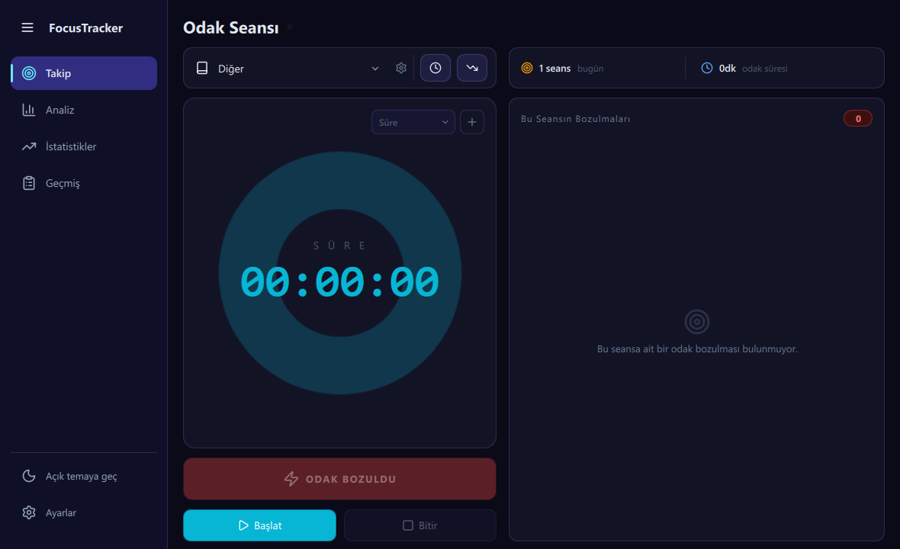
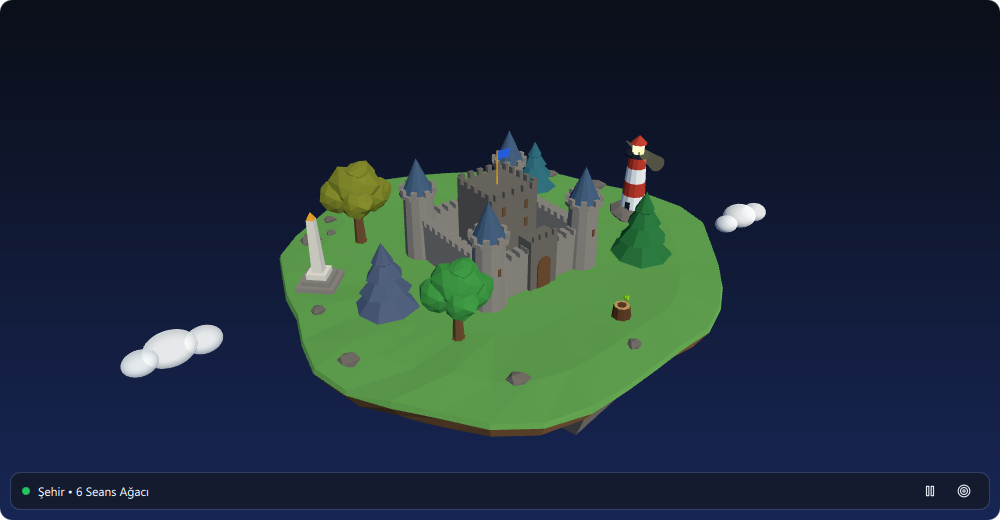
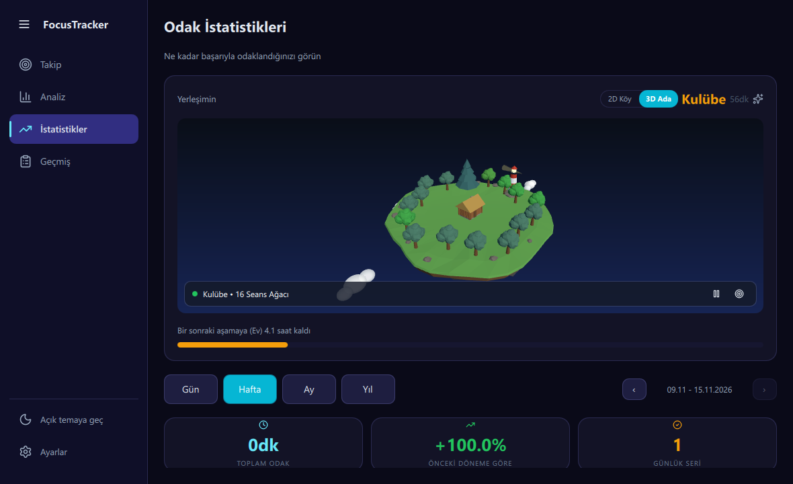
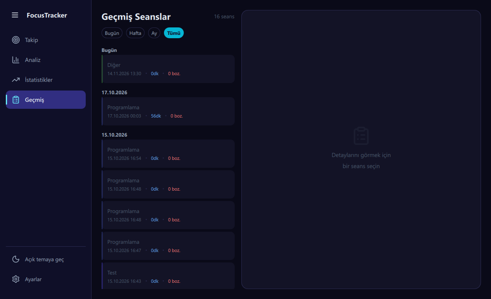

# FocusTracker


**FocusTracker**, Pomodoro tekniği ve derin odaklanma (*deep work*) ilkelerini temel alan; masaüstü deneyimini modern **Qt Quick (QML)** ve **QtQuick3D** teknolojileriyle zenginleştiren yeni nesil bir zaman yönetimi ve üretkenlik uygulamasıdır.

Uygulamanın temel felsefesi:  
> *Yalnızca ne kadar süre çalıştığınızı değil; nasıl çalıştığınızı, dikkatinizi nelerin böldüğünü ve odak kalitenizin zaman içindeki gelişimini ölçmek.*

---

## 📸 Ekran Görüntüleri

| 🎯 Odak Seansı (Koyu Tema) | 🏝️ 3D Yüzen Ada (Şehir & Kale Evresi) |
| :---: | :---: |
|  |  |

| 📊 Kapsamlı Analiz ve Dağılım | 🏝️ 3D Yüzen Ada (Kulübe Evresi) |
| :---: | :---: |
|  |  |

| 📜 Seans Geçmişi ve Filtreleme | ☀️ Odak Seansı (Açık Tema) |
| :---: | :---: |
|  |  |

---

## 🌟 Öne Çıkan Özellikler

### 1. 🎯 Fliqlo Flip Clock, Forest Geri Sayım ve Pomodoro Zamanlayıcısı
- **Kişiselleştirilebilir Fliqlo Flip Saat & Klasik Halka:** Varsayılan split-flap çevirmeli saat görünümünde 5 hazır tema, kart/rakam renkleri, cam yansıma efekti ve saydamlık ayarları sunulur; tek tıkla eski **Dairesel Halka (Klasik)** stiline de geçilebilir.
- **Zen Tam Ekran Modu:** Sayaç kartındaki büyütme butonuyla dikkat dağıtıcıları gizleyen tam pencere Fliqlo odak sahnesine (`Esc` ile çıkış) geçilebilir.
- **Forest Tarzı Hedef Geri Sayım & Serbest Kronometre:** Varsayılan `25 dk` (veya `15`, `45`, `60`, `90` dk / özel süreler) hedef süreden `00:00`'a geri sayar ve süre dolunca özet kaydını otomatik açar; istenirse **Serbest (∞)** kronometre modu kullanılabilir.
- **Kişiselleştirilebilir Pomodoro Modu:** Odak, kısa mola ve uzun mola süreleri **Ayarlar** penceresinden özelleştirilebilir.
- **Daima Üstte Mini Pencere Modu (PiP):** Ekranın bir köşesinde kalan kompakt mini pencereden seansı başlatabilir, duraklatabilir veya bitirebilirsiniz.

### 2. 🏝️ 3D Yüzen Ada ve Medeniyet Simülasyonu (Gamification)
- **Forest Tarzı Kümülatif İlerleme:** Odaklandığınız her seans adanızda yeni bir ağaç yeşertir. Başarıyla tamamlanan seanslar dersinize/projenize ait renkle çam veya meşe ağacına dönüşürken, yüksek bozulmalı seanslar taze filizli kesik kütüklere dönüşür.
- **UV Yüzey Kaplamalı 6 Aşamalı Medeniyet:** Taş, kiremit, ahşap, sıva, saman ve yaprak dokularıyla zenginleştirilmiş yapılar toplam odak süreniz arttıkça seviye atlar:
  1. *Kulübe (Hut)* ➔ Köşe kütük duvarlı, odun yığınlı orman kulübesi
  2. *Ev (House)* ➔ Verandalı, taş patikalı ve ahşap karkaslı kır evi
  3. *Çiftlik (Farm)* ➔ Tahıl silolu, saman balyalı ve dönen yel değirmenli çiftlik
  4. *Köy (Village)* ➔ Arnavut kaldırımlı meydan, üstü kapalı kuyu ve pazar tezgahlı yerleşim
  5. *Kasaba (Town)* ➔ 4 yönde altın kadranlı saat kulesi ve belediye konağı
  6. *Şehir & Kale (Castle)* ➔ İkiz burçlu kapı kulesi, mazgallı surlar ve sancaklı iç kale
- **Başarım Binaları & 2D/3D Geçiş:** Maraton başarımıyla dönen ışık huzmeli *Deniz Feneri*, 100 seans başarımıyla altın başlıklı *Zafer Anıtı* açılır; **2D Köy** ve **3D Ada** görünümleri arasında anında geçiş yapılabilir.
- **İnteraktif 3D Kontroller:** Fare ile 360° serbest döndürme (orbit), eğme açısı (pitch), tekerlekle yakınlaşma/uzaklaşma (zoom) ve çift tıkla kamerayı sıfırlama.
- **4 Dinamik Biyom Teması:** Varsayılan, Sonbahar (kehribar tonlar), Kış (karlı platolar) ve Gece (pencereleri ışıldayan yapılar).

### 3. ⚡ Odak Bozulması Takibi (Distraction Analytics)
- Çalışırken dikkatiniz dağıldığında (telefon, ani toplantı, gürültü vb.) tek tıkla **"Odak Bozuldu"** butonuna basarak nedeni kaydedin.
- Dikkatinizin hangi saatlerde ve en çok hangi kategoriler nedeniyle dağıldığını grafikler üzerinde analiz edin.

### 4. 📊 Kapsamlı Analiz ve Raporlama
- **Süre ve Kategori Dağılımı:** Hangi projelere ne kadar vakit ayırdığınızı gösteren oransal çubuklar ve grafikler.
- **Trend ve Seri (Streak) Takibi:** Önceki döneme göre odak artış/azalış yüzdesi ve ardışık gün serisi.
- **Zaman Dilimi Filtreleri:** Günlük, haftalık, aylık ve yıllık görünüm modları.

### 5. 🎨 Modern Arayüz, Erişilebilirlik ve Akıllı Ekran Desteği
- **Nötr Obsidyen Koyu & Açık Tema:** Göz yormayan nötr grafit/obsidyen koyu palet, ferah açık tema ve 6 seçilebilir vurgu rengi.
- **Klavye Navigasyonu & Çok Satırlı Notlar:** `Tab` odak halkası ve klavye aktivasyonu; otomatik satır saran ve imleci takip eden not alanları (`FTTextArea`).
- **Çoklu Monitör Güvenliği:** Sanal ekran (VDD) veya çoklu monitör kurulumlarında pencerenin kullanılabilir ekran sınırları içinde otomatik ortalanıp hizalanması.
- **Sistem Tepsisi (Tray) & Global Kısayol:** `Ctrl+Shift+F` kısayolu ile arka plandayken dahi seansı duraklatabilir veya başlatabilirsiniz.

### 6. 🔄 Kesintisiz ve Güvenli Güncelleme Altyapısı
- Uygulama açılışta GitHub Releases havuzunu kontrol eder.
- Windows Akıllı Uygulama Denetimi (Smart App Control) ile tam uyumlu **kararlı EXE mimarisi** sayesinde güncellemeler güvenlik uyarılarına takılmadan arka planda kurulur.

---

## 🚀 Kurulum Rehberi

### A) Kurulum Sihirbazı ile Kurulum (Kullanıcılar İçin - Önerilen)

1. [GitHub Releases](https://github.com/Yusufygc/Desktop_Focus_Tracker/releases) sayfasından en son yayınlanan `FocusTracker-Setup-X.Y.Z.exe` dosyasını indirin.
2. Kurulum sihirbazını çalıştırarak kurulumu tamamlayın.
3. Masaüstündeki veya Başlat menüsündeki **FocusTracker** kısayolundan uygulamayı başlatın.

### B) Kaynak Koddan Çalıştırma (Geliştiriciler İçin)

Projeyi yerel geliştirme ortamınızda çalıştırmak için:

1. **Depoyu Klonlayın:**
   ```bash
   git clone https://github.com/Yusufygc/Desktop_Focus_Tracker.git
   cd Desktop_Focus_Tracker
   ```

2. **Sanal Ortamı Oluşturun ve Aktive Edin:**
   ```bash
   python -m venv venv
   .\venv\Scripts\activate   # Windows
   ```

3. **Gerekli Paketleri Yükleyin:**
   ```bash
   pip install -r requirements.txt
   ```

4. **Uygulamayı Başlatın:**
   ```bash
   python main.py
   ```

5. **Birim Testlerini Çalıştırın:**
   ```bash
   python -m unittest discover -s tests
   ```

---

## 🛠️ Kurulum Paketi Derleme (Build & Packaging)

FocusTracker, Windows Smart App Control (SAC) standartlarına uygun **kararlı EXE mimarisi** kullanır. Exe SHA-256 imzası sürümler arasında sabit kalır; güncellemeler `_internal` dizinindeki bytecode ve veri katmanını yeniler.

1. **Derleme Bağımlılıklarını Kurun:**
   ```bash
   pip install -r requirements-build.txt
   ```

2. **3D Ada Varlıklarını Derleyin (İsteğe bağlı):**
   ```bash
   python tools/build_island_assets.py
   ```

3. **Kurulum Dosyasını Oluşturun:**
   *(Sisteminizde Inno Setup 6 kurulu olmalıdır)*
   ```bash
   python build_installer.py
   ```
   Bu işlem:
   - PyInstaller ile deterministik `FocusTracker.exe` ve bağımlılıkları `dist/FocusTracker/` içerisine derler.
   - Exe SHA-256 özetini `packaging/launcher.sha256` onay kapısıyla doğrular.
   - Inno Setup ile `dist/installer/FocusTracker-Setup-X.Y.Z.exe` ve SHA-256 doğrulama dosyasını üretir.

---

## 📂 Mimari Yapı

```
Desktop_Focus_Tracker/
├── app/
│   ├── bridge/             # QML <-> Python haberleşme köprüleri (@QmlElement, BaseBridge)
│   ├── core/               # DI Container (AppContainer), SQLite, modeller, repository'ler
│   ├── services/           # İş mantığı (Zamanlayıcı, Analiz, Odak İstatistikleri, Başarımlar, Güncelleme)
│   ├── ui/
│   │   ├── qml/            # QML arayüz sayfaları (Main, Tracker, Analytics, FocusStats, History)
│   │   │   ├── components/ # FlipClockView, ZenTimerOverlay, FTTextArea, GlassCard, diyaloglar
│   │   │   └── island3d/   # 3D ada mesh/dokuları (meshes/, maps/, imported/) ve QML 3D bileşenleri
│   │   ├── theme.py        # Nötr Obsidyen Koyu / Açık tema tokenları ve vurgu paletleri
│   │   ├── timer_settings.py # Fliqlo saat görünümü ve Zen modu tercihleri (QSettings)
│   │   ├── goal_settings.py  # Günlük / haftalık odak hedefleri (QSettings)
│   │   ├── app_config.py   # QML sabit yapılandırma adaptörü
│   │   └── strings.py      # Yerelleştirilmiş arayüz metinleri
│   └── version.py          # Tekil sürüm kaynağı (Single Source of Truth)
├── assets/island3d/        # Prosedürel glTF 2.0 3D modelleri (.glb) ve konsept görseller
├── docs/                   # Proje belgeleri, LLM Wiki (docs/wiki/), planlar ve ekran görüntüleri
├── packaging/              # Inno Setup (.iss), launcher ve sürüm meta verileri
├── tools/                  # 3D model/doku derleme ve sürüm yayınlama araçları
├── tests/                  # unittest birim ve entegrasyon testleri
├── DESIGN.md / PRODUCT.md  # Kalıcı tasarım sistemi ve ürün bağlam dokümanları
├── build_installer.py      # Tek tıkla kurulum sihirbazı üretici
└── main.py                 # Uygulama başlangıç noktası
```

---

## ⌨️ Kısayollar ve İpuçları

- `Ctrl + Shift + F`: **Global Kısayol** — Başka bir uygulamada çalışırken bile seansı anında başlatır, duraklatır veya sürdürür.
- **3D Ada Kontrolleri:**
  - `Sol Tık + Sürükle`: Adayı 360° serbest açıyla döndürün ve eğimini ayarlayın.
  - `Fare Tekerleği`: Adaya yakınlaşın veya uzaklaşın.
  - `Çift Tık`: Kamera açısını ve yakınlığını varsayılan izometrik görünüme sıfırlayın.
  - `Durdur/Başlat İkonu`: Sağ alt panelden otomatik adanın rölanti dönüşünü açıp kapatın.

---

## 📄 Lisans

Bu proje [MIT Lisansı](LICENSE) kapsamında lisanslanmıştır.
