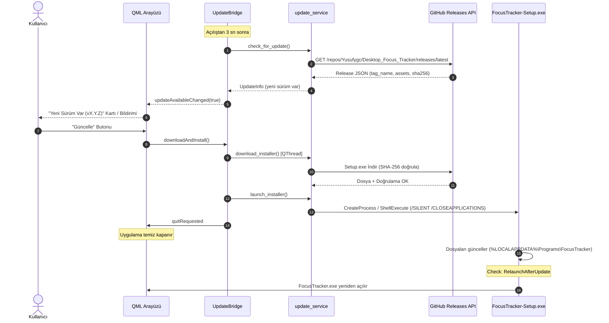

# Uygulama İçi Güncelleme Sistemi

## Genel Bakış

Paketlenmiş FocusTracker masaüstü uygulaması açılışta GitHub Releases üzerinden yeni sürüm arar. Yeni bir sürüm bulunduğunda kullanıcıya güncelleme bildirimi sunulur. **Güncelle** dendiğinde kurulum sihirbazı arka planda indirilir, SHA-256 özeti doğrulanır, uygulama kapatılarak sessiz kurulumla (`/SILENT`) mevcut sürümün üzerine yazılır ve uygulama otomatik olarak yeniden açılır.

İlgili sayfalar: [[exe-dagitim-rehberi]], [[surum-yayinlama]], [[bridges]], [[index]], [[log]].

---

## 1. Güncelleme Akışı

1. **Yayın:** GitHub'a `vX.Y.Z` etiketi push edildiğinde `.github/workflows/release.yml` çalışır, `FocusTracker-Setup-X.Y.Z.exe` ve `.sha256` dosyalarını üretip Release varlığı olarak yükler ([[surum-yayinlama]]).
2. **Denetim:** `UpdateBridge.startupCheck()` arayüz yüklendikten 3 saniye sonra `main.py` içindeki `QTimer.singleShot(3000, ...)` ile tetiklenir (testlerde ağa çıkmaz). Ağ bağlantısı yoksa veya hata oluşursa sessizce geçer. Ayarlar penceresindeki **Şimdi Denetle** butonu sonucu kullanıcıya görsel olarak bildirir.
3. **Karşılaştırma:** `update_service.is_newer()` en son sürüm etiketini `app/version.py` içindeki `__version__` ile sayısal olarak karşılaştırır (`1.10.0 > 1.9.0`). Taslak (draft) ve ön sürümler (`1.1.0-rc1`) yok sayılır.
4. **İndirme:** `DownloadWorker` arka plan iş parçacığı (`QThread`) ile çalışır; QML tarafına `downloadProgressChanged` ile yüzde bildirilir. Boyut ve SHA-256 doğrulaması **zorunludur**: Özet GitHub'ın asset `digest` alanından veya `.sha256` dosyasından okunur; ikisi de yoksa veya özet uyuşmazsa indirme iptal edilir ve dosya silinir. İndirme dizini: `%TEMP%\FocusTrackerUpdate`.
5. **Kurulum:** `/SILENT /SUPPRESSMSGBOXES /CLOSEAPPLICATIONS /LOG=<klasör>\install.log` parametreleriyle bağımsız süreç oluşturulur (`DETACHED_PROCESS`). `quitRequested` sinyali ile uygulama kapanır. `packaging/FocusTracker.iss` içindeki `Check: RelaunchAfterUpdate` kurulum bitince yeni uygulamayı otomatik açar.

---

## 2. Windows Akıllı Uygulama Denetimi (SAC) Yönetimi

İmzasız kurulum dosyası ilk çalıştırıldığında Windows SAC tarafından nadiren engellenebilir (`WinError 4551/1260`):
- `launch_installer` önce doğrudan `CreateProcess` dener; engellenirse Gezgin'in çift tıklama yolu olan `ShellExecuteW`'yi dener.
- İkisi de engellenirse `InstallerBlockedError` fırlatılır.
- `UpdateBridge` bu durumda **otomatik yeniden deneme döngüsüne** geçer: 15 saniye aralıklarla en çok 40 kez (toplam 10 dakika) kurulumu başlatmayı dener. UI üzerinde durum `waiting_windows` olur ("Windows bekleniyor...", iptal butonu).
- Engel kalktığında kurulum otomatik başlar.
- Süre dolarsa dosya Windows Gezgin'de seçili olarak gösterilir (`explorer.exe /select,...`) ve kullanıcıya "Çift tıklayarak kurabilirsiniz" mesajı verilir.

---

## 3. Mimari Katmanlar

1. **`app.services.update_service`:** Ağ istekleri, sürüm ayrıştırma, dosya indirme, SHA-256 doğrulama, süreç başlatma ve kullanıcı tercihleri (`updates.json`). UI'dan bağımsızdır, stdlib tabanlıdır, birim testlidir.
2. **`app.bridge.update_bridge.UpdateBridge`:** QML motoruna context property (`updateBridge`) ve `@QmlElement` olarak sunulur. İş parçacıklarını (`CheckWorker`, `DownloadWorker`) yönetir.
3. **Kullanıcı Tercihleri:** `%APPDATA%\FocusTracker\updates.json` dosyasında `check_enabled` (otomatik denetim açık/kapalı) ve `skipped_version` (kullanıcının "Bu sürümü atla" dediği sürüm) saklanır.
4. **Devre Dışı Bırakma:** Ortam değişkeni `FOCUSTRACKER_NO_UPDATE_CHECK=1` tanımlandığında tüm açılış denetimleri atlanır.

---

## 4. Güvenlik Kuralları

- İndirme adresi yalnızca `https://github.com/Yusufygc/Desktop_Focus_Tracker/releases/download/...` yolu olabilir; yönlendirmeler yalnızca `github.com` veya `*.githubusercontent.com` adreslerine kabul edilir.
- Dosya adı katı desene uymak zorundadır: `^FocusTracker-Setup-[0-9.]+\.exe$`.
- Boyut sınırı: En fazla 400 MB.
- SHA-256 doğrulaması zorunludur. Doğrulama başarısız olursa dosya derhal silinir.
- Kimlik bilgisi, kullanıcı token'ı veya özel veri asla gönderilmez (`User-Agent: FocusTracker/<version>` kullanılır).
